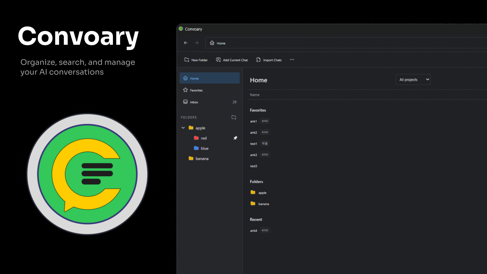

# Convoary

Organize, search, and manage your AI conversations.
Currently supports ChatGPT conversations in a separate Explorer-style window.
An independent **v0.1 alpha** extension for Chrome, Edge, Firefox and Zen.
Not affiliated with or endorsed by OpenAI.

## Demo

[](https://youtu.be/8-YvxsedAxQ)

[Watch on YouTube](https://youtu.be/8-YvxsedAxQ)

## Features

- Nested folders, favorites, colors, search and filters.
- Multi-selection, drag and drop, inline rename and keyboard shortcuts.
- Import chats from the visible sidebar, current chat or open tabs.
- Theme and workspace JSON import/export, with local backups.
- Optional encrypted Dropbox sync across browsers and devices.

Your organization stays local unless you enable sync. Source conversations are never modified. Sidebar import depends on the source website's interface and may not find every conversation.

## Install

Download the ZIP for your browser from [Releases](https://github.com/GIRIBUIN/convoary/releases) and extract it.

- **Chrome / Edge:** open the extensions page, enable Developer mode, choose **Load unpacked**, and select the extracted folder.
- **Firefox / Zen (140+):** open `about:debugging#/runtime/this-firefox`, choose **Load Temporary Add-on**, and select the extracted `manifest.json`. This unsigned alpha installation lasts until the browser restarts.

Click the extension icon to open Convoary.

Updating an unpacked installation? Back up your Workspace and Sync Key, replace files in the same installation folder, and reload the extension. Avoid removing/reinstalling it or changing its load path.

## Dropbox sync

Connect your own Dropbox account in Settings. Sync data is encrypted on-device and stored in your dedicated Dropbox sync folder. The existing folder path is retained for compatibility; see [sync setup](docs/SYNC.md).

**The app requests Full Dropbox access**, but its code only uses the dedicated sync file and an old root file for migration. This is a code restriction, not a Dropbox-enforced sandbox.

Keep your **Sync Key** private and copy it to other devices. It is not stored in Dropbox. Disconnect preserves the local key; uninstalling the extension may remove it.

[Setup and key recovery](docs/SYNC.md) · [Privacy](PRIVACY.md) · [Security](SECURITY.md)

## Development

Use Node.js 24 LTS.

```sh
npm ci
# Copy .env.example to .env.local and set VITE_DROPBOX_CLIENT_ID for sync.
npm run build:chromium
npm run build:firefox
```

Load `dist/chromium` or `dist/firefox/manifest.json` as above. Register your extension's Dropbox redirect URI before testing OAuth; see [sync setup](docs/SYNC.md).

Checks: `npm run typecheck`, `npm run lint`, `npm test`. Optional browser checks are listed by `npm run`; they require Playwright Chromium or `PLAYWRIGHT_EXECUTABLE_PATH` pointing to Chrome/Edge.

## License

[MIT](LICENSE) · [Third-party notices](THIRD_PARTY_NOTICES.md)
